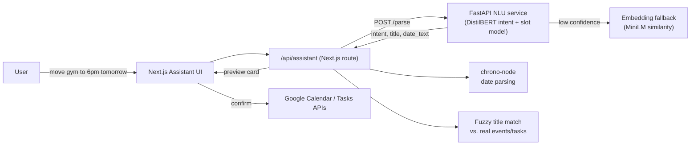

# Nexis

**A personal productivity dashboard with a self-built natural-language assistant.**

Nexis brings Google Calendar, Gmail and Google Tasks into one Next.js dashboard. It also has an assistant that turns plain-English commands like *"move team meeting to Friday at 3pm"* or *"remind me to call mum next week"* into real actions on your Google account.

The assistant does **not** call an external LLM. Language understanding is handled by a **DistilBERT model I fine-tuned myself** for joint intent classification and slot filling. It is served from a local FastAPI microservice and backed by an embedding-similarity fallback for phrasing the model hasn't seen.

---

## Features

### Dashboard
- **Google sign-in** with NextAuth (OAuth 2.0), with access-token refresh
- **Home:** today's calendar events, open tasks and today's emails at a glance
- **Calendar:** view, create, edit and delete Google Calendar events
- **Tasks:** view, create, complete and delete Google Tasks
- Sidebar navigation, dark UI built with Tailwind CSS

### Assistant
- Type a command in natural language and the NLU service extracts:
  - **Intent:** `add_event`, `update_event`, `delete_event`, `add_task`, `complete_task`, `delete_task`, `list_today`
  - **Slots:** the item's `TITLE` and a `DATE` phrase (BIO-tagged)
- **Date resolution:** the extracted date phrase (e.g. *"next Tuesday at 9am"*) is parsed with `chrono-node`, always resolving forward in time
- **Fuzzy matching:** for edits, deletes and completions, the spoken title is matched against your real events and tasks using word-overlap scoring
- **Confirm before write:** every action shows a preview card first (title, time, or old → new for reschedules). Destructive actions are styled red, and nothing changes in Google until you confirm.
- **Week preview:** a live hour-grid calendar view shows your existing week with the pending event highlighted
- `list_today` replies inline with today's events and tasks

---

## Architecture



| Layer | Tech |
|---|---|
| Frontend | Next.js (App Router), React, TypeScript, Tailwind CSS, lucide-react |
| Auth | NextAuth (Google provider), google-auth-library |
| Google APIs | Calendar v3, Tasks v1, Gmail v1 (read-only) via REST and `googleapis` |
| NLU service | Python, PyTorch, Hugging Face Transformers, FastAPI, Uvicorn |
| Models | `distilbert-base-uncased` (fine-tuned), `all-MiniLM-L6-v2` (fallback embeddings) |

---

## The NLU model

All NLU code lives in [`nlu/`](nlu/).

### Model
A single DistilBERT encoder with **two heads trained jointly**:

- **Intent head:** linear layer on the `[CLS]` representation → intent class
- **Slot head:** linear layer on every token → BIO tag (`B-TITLE`, `I-TITLE`, `B-DATE`, `I-DATE`, `O`)

The two cross-entropy losses are summed (`loss = intent_loss + slot_loss`), so the shared encoder learns both tasks at once. Sub-word tokens are aligned to word-level labels, with non-first sub-tokens ignored (`-100`).

### Training data
There was no off-the-shelf dataset for this task, so I wrote a **template-based generator** ([`generate_dataset.py`](nlu/generate_dataset.py)). It combines sentence templates with banks of titles and date phrases to produce **3,000+ BIO-labelled examples**, for example:

```json
{
  "text": "todo: call mum next week",
  "tokens": ["todo:", "call", "mum", "next", "week"],
  "tags":   ["O", "B-TITLE", "I-TITLE", "B-DATE", "I-DATE"],
  "intent": "add_task"
}
```

### Pipeline
```
generate_dataset.py  →  verify_dataset.py  →  prepare_data.py  →  train.py
   build examples        sanity-check          tokenise + align     fine-tune
                         token/tag lengths     labels to sub-words  & save model.pt
```

### Training setup
- Optimiser: AdamW, learning rate `2e-5`
- 8 epochs, batch size 16, 90/10 train/validation split
- Max sequence length 32
- Trained locally on an NVIDIA RTX 2060 Super (CUDA)

### Hybrid fallback
Template-generated data teaches sentence *shape* as much as vocabulary, so unusual phrasings can confuse the classifier. When the intent confidence drops below **0.6**, [`embedding_fallback.py`](nlu/embedding_fallback.py) embeds the input with `all-MiniLM-L6-v2` (manual mean pooling and L2 normalisation, no `sentence-transformers` dependency). It then picks the intent whose hand-written reference examples are most similar by cosine similarity.

### Serving
[`serve.py`](nlu/serve.py) exposes the model through FastAPI:

```http
POST /parse   { "text": "move team meeting to friday at 3pm" }
→ { "intent": "update_event", "title": "team meeting", "date_text": "friday at 3pm",
    "confidence": 0.97, "used_fallback": false }

GET  /health  → { "status": "ok" }
```

### Learning exercise
[`from_scratch_nn.py`](nlu/from_scratch_nn.py) is a small neural network written in pure NumPy: forward pass, manual backpropagation and gradient descent, trained on XOR. I built it to understand the maths before moving on to PyTorch and transformers.

---

## Getting started

### Prerequisites
- Node.js 20+ and npm
- Python 3.10+ (CUDA GPU optional but recommended for training)
- A Google Cloud project with the **Calendar**, **Tasks** and **Gmail** APIs enabled and an OAuth 2.0 client (redirect URI `http://localhost:3000/api/auth/callback/google`)

### 1. Web app
```bash
npm install
cp .env.example .env.local
```

Then fill in `.env.local`:
```env
GOOGLE_CLIENT_ID=your-client-id
GOOGLE_CLIENT_SECRET=your-client-secret
NEXTAUTH_URL=http://localhost:3000
NEXTAUTH_SECRET=any-long-random-string   # e.g. openssl rand -base64 32
NLU_URL=http://localhost:8000
```

### 2. NLU service
```bash
cd nlu
python -m venv nexis-nlu
source nexis-nlu/bin/activate        # Windows: nexis-nlu\Scripts\activate
pip install -r requirements.txt

# build the dataset and train the model (creates model.pt)
python generate_dataset.py
python verify_dataset.py
python prepare_data.py
python train.py
```

### 3. Run both servers
```bash
# terminal 1, in nlu/
uvicorn serve:app --reload --port 8000

# terminal 2, in the project root
npm run dev
```

Open http://localhost:3000, sign in with Google and try the **Assistant** page.

---

## Project structure
```
app/
  api/
    assistant/        NLU → action pipeline (intent routing, date parsing, fuzzy matching)
    auth/             NextAuth Google OAuth
    calendar/events/  Calendar CRUD (GET/POST/PATCH/DELETE)
    gmail/            Today's emails (read-only)
    tasks/            Tasks CRUD
  assistant/ calendar/ tasks/   Pages
components/           Sidebar, forms, confirm buttons, CalendarWeekPreview
lib/auth.ts           NextAuth config + token refresh
lib/config.ts         App and NLU service URLs (from env)
types/                Google API and assistant action types
nlu/                  Dataset generation, training, inference and FastAPI service
```

---

## Limitations and roadmap
- [ ] **Evaluation on a held-out, hand-written test set.** Validation accuracy is currently measured on template-generated data, so it overstates real-world performance. The next step is 40–50 natural sentences with intent accuracy and slot F1 reported.
- [ ] Broader phrasing coverage for `update_event`, `delete_event` and `delete_task`
- [ ] Full Mail page
- [ ] Containerise the NLU service so the app runs with a single command
